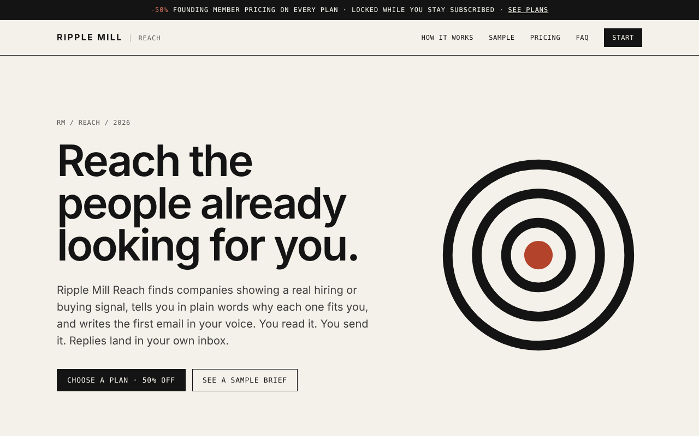
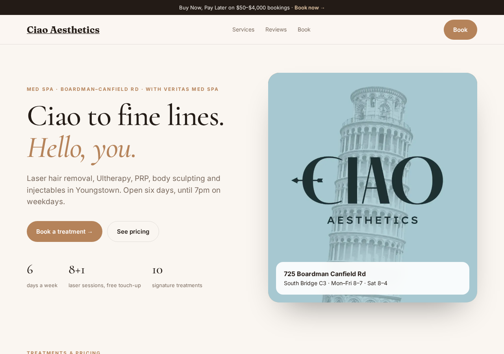

<p align="center"></p>

<p align="center">
<a href="https://ripplemill.com"></a>
<a href="https://ripplemill-reach.vercel.app"></a>
<a href="https://millzbot.vercel.app/about/"></a>
<a href="https://x.com/mllzi"></a>
<a href="mailto:uhh27@proton.me"></a>
</p>

### Millz

Owner-operator of **[Ripple Mill](https://ripplemill.com)**, a one-person studio for brand, web and lead generation. Self taught. Everything here was designed, written and shipped by me, first-hand.

```
focus     brand identity · websites · lead generation · outreach systems
also      customer support ops · healthcare revenue cycle (claims, AR follow-up)
studying  attention, trust and why people buy (Millzbot)
works     remote · async · in writing
```

### Now shipping

<table>
<tr>
<td width="50%" valign="top">
<a href="https://ripplemill-reach.vercel.app"></a><br>
<b>Ripple Mill Reach</b> · subscription product<br>
<sub>Finds companies with a live hiring or buying signal, explains in plain words why each one fits, and drafts a unique first email. The member sends it from their own inbox.</sub><br>
<sub><a href="https://ripplemill-reach.vercel.app">ripplemill-reach.vercel.app</a></sub>
</td>
<td width="50%" valign="top">
<a href="https://ripplemill.com"></a><br>
<b>Ripple Mill</b> · studio site<br>
<sub>A consistent system for being found, understood and chosen. Brand identity, lead generation, search and website visibility, local presence, social and content.</sub><br>
<sub><a href="https://ripplemill.com">RippleMill.com</a> · <a href="https://github.com/jpxgs/ripplemill">source</a></sub>
</td>
</tr>
</table>

### Index

| Project | What it is | Link |
|---|---|---|
| **Ripple Mill Reach** | Outreach subscription: demand-signal leads, fit notes and one-off first emails, three monthly plans | [live](https://ripplemill-reach.vercel.app) |
| **Ripple Mill** | Studio site and service system: five service areas, process, scope, written-first contact | [live](https://ripplemill.com) · [source](https://github.com/jpxgs/ripplemill) |
| **FIELDNOTES** | Signal library of curated talks and deep-value material, in a black, white and grey dithered design | [live](https://signal-video.vercel.app) |
| **Doug Stanhope site** | Redesign of the comedian's official site, plus recovery work on the original 2010 site | [live](https://dougstanhope.vercel.app) · [source](https://github.com/jpxgs/dougstanhope) |
| **Millzbot** | Portfolio and study archive: psychology, Jung and archetypes, philosophy, motivation, creativity | [live](https://millzbot.vercel.app) · [source](https://github.com/jpxgs/millzbot) |
| **Concept demos** | Site concepts built from each business's public branding to show what's possible | [repo](https://github.com/jpxgs/demos) |

#### Concept demos
<sub>Unsolicited concept builds made from each business's public branding. Not commissioned work.</sub>

<table>
<tr>
<td width="50%"><a href="https://lloyd-derm-demo.vercel.app"></a><br><b>Dermatology practice</b> · concept</td>
<td width="50%"><a href="https://landen-motors-demo.vercel.app"></a><br><b>Auto dealership</b> · concept</td>
</tr>
<tr>
<td><a href="https://ciao-aesthetics-demo.vercel.app"></a><br><b>Aesthetics studio</b> · concept</td>
<td><a href="https://rich-law-canton-demo.vercel.app"></a><br><b>Law firm</b> · concept</td>
</tr>
</table>

### What I do

| | |
|---|---|
| **Brand & design** | Identity, logos, social kits, headers, launch pages |
| **Websites** | Art-directed static sites for local businesses and creators, deployed on Vercel |
| **Lead generation** | Demand-signal research, lead scoring, outreach written one message at a time |
| **Communities** | Discord servers built and run, with the bots behind them |
| **Video** | Basic edits: trims, color grading, audio cleanup |
| **Operations** | Remote customer support, small-business ops, revenue cycle follow-up |

### Earlier

Digital art curation at Exchange Art, where Millzbot started as a public feed surfacing artists whose work sold through fast and kept real secondary demand. Before that: brand and creative direction at Ran Global, office management at Local BPO Values, and remote customer service at AT&T Mobility.

### Tools

`HTML` `CSS` `JavaScript` `Python` `Vercel` `GitHub` `Canva` `Photoshop` `DaVinci Resolve` `Google Workspace` `Microsoft Office`

### Contact

**Email** [uhh27@proton.me](mailto:uhh27@proton.me) · [uhhmillz@gmail.com](mailto:uhhmillz@gmail.com)  
**X** [@mllzi](https://x.com/mllzi) · **Pinterest** [@mllzi](https://pinterest.com/mllzi/) · **Discord** `mllzi`  
Replies in writing.

<p align="center"><sub>We make beauty in the face of agony.</sub></p>
