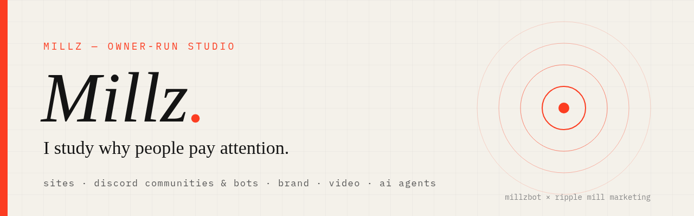
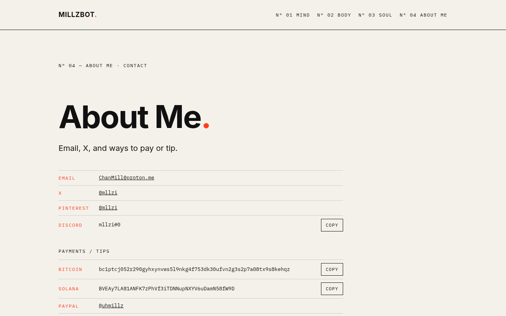
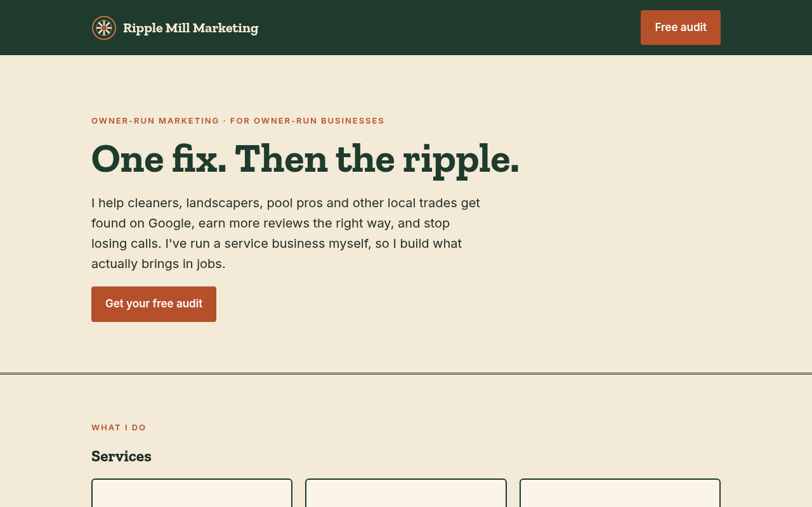
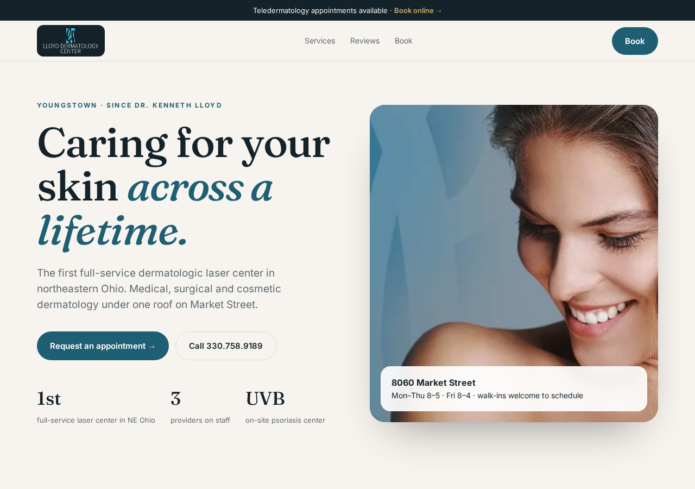
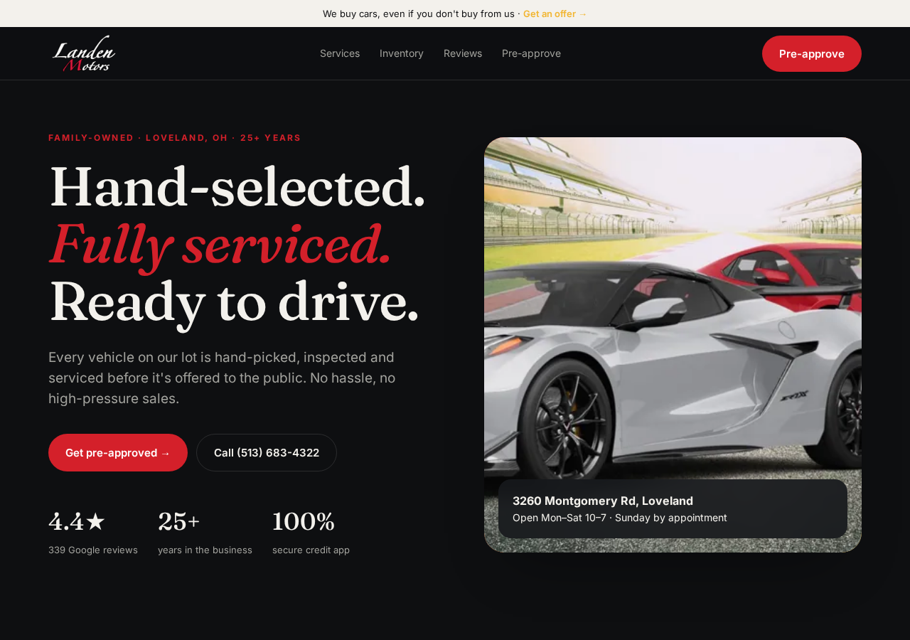
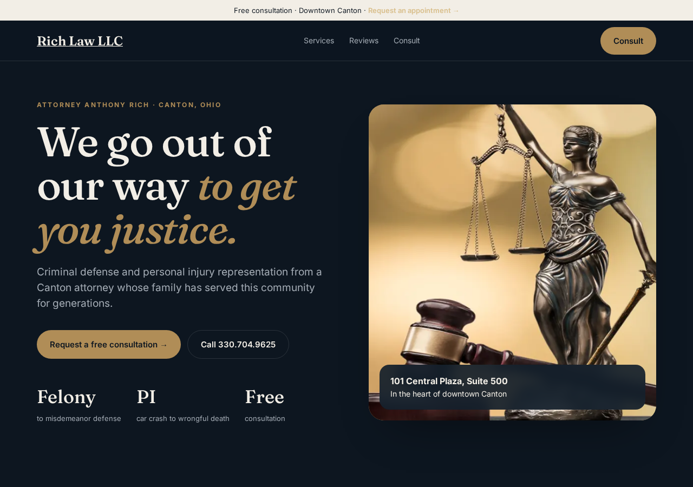

### You work with Millz. Not a handoff.

I'm **Millz**, the owner behind **[Ripple Mill Marketing](https://ripplemill.vercel.app)** and **[Millzbot](https://millzbot.vercel.app)**. One person, every job done first-hand:

| | |
|---|---|
| **Websites** | Fast, art-directed sites for local businesses and creators, live in days |
| **Discord** | Communities built and run, plus the custom bots behind them (verify, roles, alerts, drops) |
| **Brand & design** | Logos, identity, social kits, launch pages |
| **Video** | Edits and short-form cuts that hold attention |
| **Marketing ops** | Lead gen, outreach, support systems, operations |
| **AI agents** | Grok Bot setups that do real work: research, outreach, demos, routines |

### I study why people pay attention.

[Millzbot](https://millzbot.vercel.app) is my body of study: psychology, Jung and archetypes, philosophy, motivation and creativity, sorted into **Mind · Body · Soul**. It's why the work lands with people instead of reading like a template.

### Selected work

<table>
<tr>
<td width="50%"> <b>Millzbot</b> · portfolio + study archive <a href="https://github.com/jpxgs/millzbot">source</a></td>
<td width="50%"> <b>Ripple Mill Marketing</b> · owner-run agency <a href="https://github.com/jpxgs/ripplemill">source</a></td>
</tr>
</table>

#### Concept demos
Unsolicited concept builds made from each business's public branding to show what's possible. Not commissioned work.

<table>
<tr>
<td width="50%"> <b>Dermatology practice</b> · concept</td>
<td width="50%"> <b>Auto dealership</b> · concept</td>
</tr>
<tr>
<td> <b>Aesthetics studio</b> · concept</td>
<td> <b>Law firm</b> · concept</td>
</tr>
</table>

More concepts live in **[jpxgs/demos](https://github.com/jpxgs/demos)**.

### Stack

`HTML` `CSS` `JavaScript` `Python` `Vercel` `GitHub Pages` `Discord bots` `Canva` `Figma` `AI agents`

### Contact

**Email** [uhhmillz@gmail.com](mailto:uhhmillz@gmail.com) · [uhh27@proton.me](mailto:uhh27@proton.me)  
**X** [@mllzi](https://x.com/mllzi) · **Pinterest** [@mllzi](https://pinterest.com/mllzi/) · **Discord** `mllzi`

We make beauty in the face of agony.

